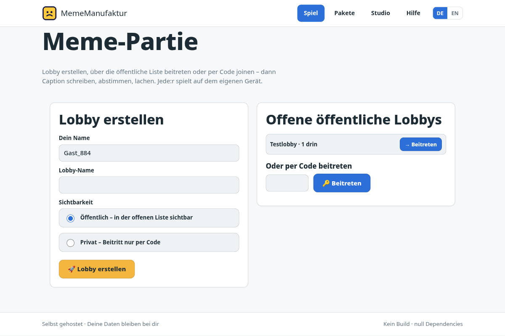

# 🎨 MemeMacher

A self-hostable **meme party game** — your instance, your design, your data:

- 🖌️ **Meme Studio** — drag & scale text, outline, highlight, image filters,
  PNG/JPEG export and clipboard copy. Everything renders locally in your browser.
- 📦 **Your own meme packs** — upload pictures, organize them into packs, use
  them in the studio and in the game. Stored in your browser (IndexedDB) or,
  when the server is running, shared with everyone on the network.
- 🎉 **Party mode** – create a lobby, everyone joins in their own browser:
  rounds, themes, voting and a meme-king coronation. Public lobbies can be
  joined from an open list; private ones work by code only.
- 👤 **Accounts (optional)** — sign up with email + password, no verification.
  Each account gets its own server storage up to **250 MB**; in a LAN match,
  the host can allow players to attach their own packs.
- 🗳️ **Community voting** — upvote memes in the shared library from your
  account (one vote per account, toggleable); the list is sorted by votes.
- 🌍 **English first**, switchable to German in the UI.

No build step, zero dependencies: vanilla ES modules + a zero-dependency
Node server (≥ 18) that adds static hosting, a shared upload library and a
hand-rolled WebSocket relay for LAN games.

| |
| --- |
|  |

## Quickstart

### 1) Full mode (recommended): Node server

```bash
node server.js
# → http://localhost:8080
```

Friends on the same network open `http://<your-ip>:8080` — the shared picture
library and LAN matches are now active. Or via npm:

```bash
npm start
```

### 2) Docker

```bash
docker compose up -d --build
# → http://localhost:8080
```

Uploads persist in the named volume `meme-data` (mounted at `/app/data`).

### 3) Static only (offline)

Any webserver works, e.g.:

```bash
python3 -m http.server 8080
```

Without the server you lose the shared uploads, voting and the game — the
game needs the server to register lobbies and relay messages. Packs then stay
in your browser.

## How a game runs

1. Create a lobby – public (joinable from the open list) or private (code
   only). Public lobbies show up in the list with player counts.
2. Everyone joins in their own browser; the first person in is the host.
3. The host starts the rounds: each player writes a caption for their
   template — against the clock.
4. Everyone votes for the best memes, points flow, and after the final round
   a meme royalty is crowned. Confetti included.

The server only **relays messages** (and keeps the lobby list); all game
logic runs client-side.

## Where do my pictures go?

| Mode | Storage |
| --- | --- |
| Local (browser) | IndexedDB — only you can see them |
| Shared (server) | `./data/uploads/` + index `./data/library.json` |
| With an account | Server storage, private to your account (up to 250 MB per account); accounts need the Node server |

"A also save to server" ("Auch auf dem Server speichern") can be toggled per
upload on the Packs page. In LAN matches, the host can allow players to use
their own (private) packs.

## HTTP API & WebSocket

| Endpoint | Method | Purpose |
| --- | --- | --- |
| `/health` | GET | Liveness check |
| `/api/register` | POST | Create an account (JSON: `email`, `password`; no verification) |
| `/api/login`, `/api/logout` | POST | Session via `HttpOnly` cookie |
| `/api/me` | GET | Current user + storage usage |
| `/api/library` | GET | Shared templates + your own, sorted by votes (private entries only for their owner) |
| `/api/vote` | POST | Toggle your upvote on an entry (JSON: `id`; needs a session) |
| `/api/lobbies` | GET | Open public lobbies (`code`, `name`, `players`) |
| `/api/upload` | POST | Create/update a template (JSON: `id`, `name`, `mime`, `data` as base64) |
| `/api/library/:id` | DELETE | Remove a template (own entries only by their owner) |
| `/uploads/:id` | GET | Fetch an uploaded image |
| `/ws?room=CODE&name=NAME&self=ID&pub=1&lobby=NAME` | WS | Game relay — the first connection registers the lobby; join, roster, round state, votes |

Limits: 25 MB per uploaded image, 250 MB per account, 8 MB per WebSocket message.

## Configuration

| Variable | Default | Meaning |
| --- | --- | --- |
| `PORT` | `8080` | HTTP port |
| `HOST` | `0.0.0.0` | Bind address |
| `MEME_DATA_DIR` | `./data` | Data directory (uploads + library index) |
| `MEME_USER_QUOTA_BYTES` | `262144000` | Storage quota per account (250 MB) |

## Project structure

```
index.html          Entry point (also works fully static)
css/styles.css      Design system (simple, light, plain CSS tokens)
js/lib.js           i18n (EN/DE), utilities
js/packs.js         Pack API (IndexedDB) + server API client
js/editor.js        MemeCanvas render engine
js/ui-studio.js     Studio page
js/ui-packs.js      Packs page
js/net.js           WebSocket client (Room)
js/game.js          Party game: lobbies + rounds
js/main.js          Router, nav/footer, help
server.js           Zero-dep Node server (static, uploads, WS relay)
assets/templates/   Built-in SVG templates (the "Classics" pack)
assets/screenshot.png  Home page screenshot (used in this README)
test/smoke.mjs      API smoke tests (node:test)
data/uploads/       Shared images (created automatically)
```

## Testing

```bash
npm test
```

Runs the dependency-free smoke suite (`node --test`) against an isolated data
directory — covers health, static serving, upload round-trips, content-type
hygiene, deletion, accounts, private visibility, the storage quota, voting and
lobbies.

---

Your data stays where you host it.
