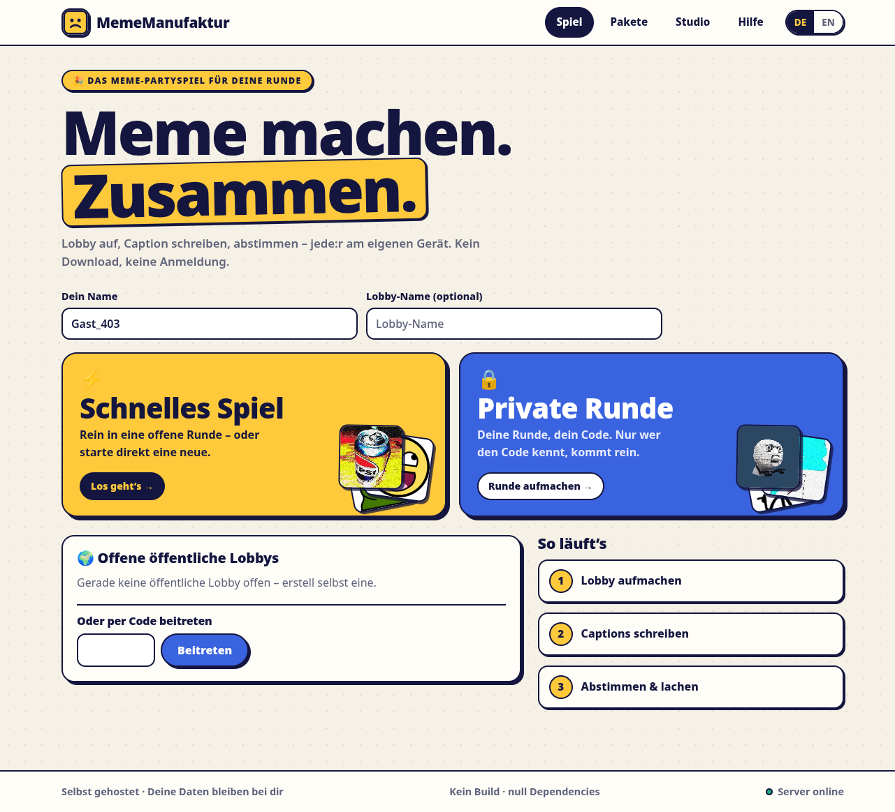

# 🎨 MemeManufaktur

A self-hostable **meme party game** — your instance, your design, your data:

- 🖌️ **Meme Studio** — visual template gallery, drag & scale text, outline,
  highlight, image filters, keyboard shortcuts, PNG/JPEG export and clipboard
  copy. Everything renders locally in your browser.
- 📦 **Your own meme packs** — upload pictures, organize them into packs, search
  them and use them in the studio and in the game. Stored in your browser
  (IndexedDB) or, when the server is running, shared with everyone on the
  network. The shared library loads in pages instead of all at once.
- 🎉 **Party mode** — quick play or a private lobby, everyone joins in their own
  browser: 1–8 rounds, themes, captions, voting and a meme-king coronation.
  2–30 players per lobby, caption time 30–300 s, host rematch, and a stable host
  connection across short reconnects. Public lobbies can be joined from an open
  list; private ones work by code only. Invite code and link are one click away.
- 👤 **Accounts (optional)** — sign up with email + password, no verification.
  Each account gets its own server storage up to **250 MB**; in a LAN match,
  the host can allow players to attach their own packs.
- 🗳️ **Community voting** — upvote memes in the shared library from your
  account (one vote per account, toggleable); the list is sorted by votes.
- 🌍 **Bilingual DE/EN**, German by default, with localized page titles.
- 📱 **Installable** — web app manifest and icons; works as a home-screen app
  when the browser supports it.

No build step, zero dependencies: vanilla ES modules + a zero-dependency
Node server (≥ 18) that adds static hosting, a shared upload library and a
hand-rolled WebSocket relay for LAN games.

| |
| --- |
|  |

## Quickstart

### 1) Full mode (recommended): Node server

```bash
node server.js
# → http://localhost:8080
```

Friends on the same network open `http://<your-ip>:8080` — the shared picture
library and LAN matches are now active. Or via npm:

```bash
npm start
```

If `8080` is blocked or already taken (common on Windows with Hyper-V), pick
another port: `PORT=8081 node server.js` on macOS/Linux, or
`$env:PORT=8081; node server.js` in PowerShell.

### 2) Docker

```bash
docker compose up -d --build
# → http://localhost:8080
```

Uploads persist in the named volume `meme-data` (mounted at `/app/data`). The
image runs as the non-root `node` user and ships a `/health` check; a
`.dockerignore` keeps uploads, git history and tests out of the build context.

### 3) Static only (offline)

Any webserver works, e.g.:

```bash
python3 -m http.server 8080
```

Without the server you lose the shared uploads, voting and the game — the
game needs the server to register lobbies and relay messages. Packs then stay
in your browser.

## How a game runs

1. Pick **Quick play** (jump into an open public lobby or start one) or
   **Private game** (code only). Public lobbies show up in the list with
   player counts; the invite code and link are copyable in the lobby.
2. Everyone joins in their own browser; the first person in is the host.
3. The host picks 1–8 rounds, a mode, the caption time and the player limit,
   then starts: each player writes a caption for their template — against the
   clock.
4. Everyone votes for the best memes and can award one ⛰️ PEAK per round;
   the next meme follows automatically after a vote. Points flow, memes can be
   saved as images, and after the final round the MemeManufakteur is crowned.
   Confetti included; the host can start a rematch with the same group.

The server only **relays messages** (and keeps the lobby list and limits);
all game logic runs client-side.

## Where do my pictures go?

| Mode | Storage |
| --- | --- |
| Local (browser) | IndexedDB — only you can see them |
| Shared (server) | `./data/uploads/` + index `./data/library.json` |
| With an account | Server storage per account (up to 250 MB); private entries stay out of the public library and away from anonymous visitors, but signed-in players on the same server can load them by ID for LAN games. Accounts need the Node server |

"Also save to server" ("Auch auf dem Server speichern") is off by default and
can be toggled per upload on the Packs page. Anonymous shared uploads are tied
to an `HttpOnly` browser cookie, so the browser that uploaded them (and only
that browser) can remove them again. In LAN matches, the host can allow
players to use their own (private) packs.

## HTTP API & WebSocket

| Endpoint | Method | Purpose |
| --- | --- | --- |
| `/health` | GET | Liveness check |
| `/api/register` | POST | Create an account (JSON: `email`, `password`; no verification) |
| `/api/login`, `/api/logout` | POST | Session via `HttpOnly` cookie |
| `/api/me` | GET | Current user + storage usage |
| `/api/library` | GET | Shared templates + your own, sorted by votes (private entries only for their owner) |
| `/api/vote` | POST | Toggle your upvote on an entry (JSON: `id`; needs a session) |
| `/api/lobbies` | GET | Open public lobbies (`code`, `name`, `players`, `max`) |
| `/api/upload` | POST | Create/update a template (JSON: `id`, `name`, `mime`, `data` as base64) |
| `/api/library/:id` | DELETE | Remove a template (own entries only by their owner) |
| `/uploads/:id` | GET | Fetch an uploaded image (session required for private entries) |
| `/ws?room=CODE&name=NAME&self=ID&token=SECRET&pub=1&create=1&lobby=NAME&max=12` | WS | Game relay — the first connection creates the lobby; join, roster, round state, votes. `token` guards reconnects, `create` prevents code collisions |

Limits: 25 MB per uploaded image, 250 MB per account, 500 MB for the shared
anonymous library, 8 MB per WebSocket message. SVG uploads are rejected on
purpose: SVG can carry scripts and would run in the app origin. Only PNG, JPEG,
GIF and WebP are accepted, detected by magic bytes.

## Security & exposure

This is a LAN-first, self-hosted app. A few deliberate guardrails:

- Static hosting is allow-listed to `index.html`, `favicon.svg`,
  `manifest.webmanifest`, `css/`, `js/` and `assets/`. `data/`, `.git/`,
  `test/` and the server source are **not** reachable over HTTP.
- Uploads are accepted only as PNG, JPEG, GIF or WebP, detected by magic bytes.
  SVG uploads are rejected because SVG can execute scripts in the app origin.
- Private entries are excluded from the public library and require a session;
  signed-in players on the same instance can load them by ID during a LAN game.
  Do not treat them as end-to-end secrets on a shared server.
- Anonymous shared uploads are owned by the uploader's `HttpOnly` browser
  cookie; other visitors can use them but not delete them.
- Each browser connection has a secret reconnect token. A player can see other
  player IDs in the roster but cannot impersonate the host by reusing that ID;
  only the matching token may replace a connection. Lobby codes are
  first-come-first-served and joining a code that does not exist is rejected.
- Passwords are hashed with scrypt; sessions are HttpOnly cookies (with
  `Secure` when served over HTTPS) and expire server-side after 30 days.
- There is no built-in TLS. If you expose the instance to the internet, put it
  behind an HTTPS reverse proxy and review the sharing defaults first.

## Configuration

| Variable | Default | Meaning |
| --- | --- | --- |
| `PORT` | `8080` | HTTP port |
| `HOST` | `0.0.0.0` | Bind address |
| `MEME_DATA_DIR` | `./data` | Data directory (uploads + library index) |
| `MEME_USER_QUOTA_BYTES` | `262144000` | Storage quota per account (250 MB) |
| `MEME_ANON_QUOTA_BYTES` | `524288000` | Storage quota for the shared anonymous library (500 MB) |

## Project structure

```
index.html             Entry point (also works fully static)
manifest.webmanifest   Installable web-app manifest
css/styles.css         Design system (warm paper, navy, yellow, tokens)
css/chrome.css         Skip link, server status, error card
css/studio.css         Visual template gallery and studio tools
css/packs.css          Search, paged server library, upload states
css/game.css           Lobby, voting, result and finale polish
js/lib.js              i18n (EN/DE), utilities
js/packs.js            Pack API (IndexedDB), built-in catalog + server client
js/editor.js           MemeCanvas render engine (incl. layer duplicate)
js/ui-studio.js        Studio page
js/ui-packs.js         Packs page
js/net.js              WebSocket client (Room)
js/game.js             Party game: lobbies + rounds
js/main.js             Router, nav/footer, help
server.js              Zero-dep Node server (static, uploads, WS relay)
assets/templates/      15 built-in meme templates (optimized, ~1.6 MB)
assets/icon-*.png      App icons (PWA / home screen)
assets/screenshot.png  Home page screenshot (used in this README)
test/smoke.mjs         API smoke tests (node:test)
test/invariants.mjs    Template catalog, i18n and utility invariants
test/ws.mjs            Lobby limit, reconnect token and host-authority tests
data/uploads/          Shared images (created automatically)
```

Built-in template licenses and sources are listed in
`assets/templates/LICENCES.txt`.

## Testing

```bash
npm test
```

Runs the dependency-free suite (`node --test`) against an isolated data
directory. The smoke tests cover health, static serving, upload round-trips,
content-type hygiene, deletion, accounts, private visibility, the storage quota,
voting and lobbies. The invariant tests check the built-in template catalog
against the files on disk, DE/EN key parity, and the room-code/shuffle helpers.
The WebSocket tests cover lobby limits, reconnect tokens, host-only control and
targeted turn messages (they use Node's built-in `WebSocket` and are skipped on
Node 18).

---

Your data stays where you host it.
